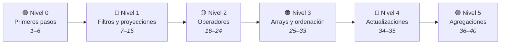
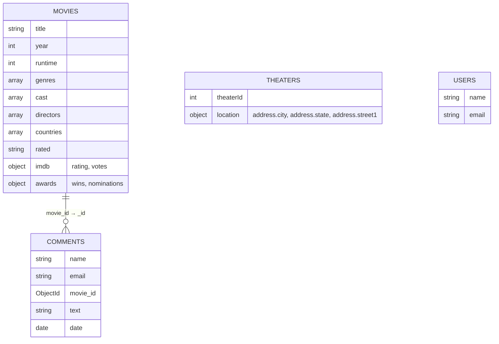

<div align="center">

# 🍃 Ejercicios MongoDB — sample_mflix

**40 ejercicios resueltos y explicados sobre la base de datos de películas de MongoDB Atlas, ordenados de más fácil a más difícil: desde el primer `find()` hasta pipelines de agregación con `$lookup`.**


</div>

---

## De un vistazo

| | |
|---|---|
| 🗄️ **Base de datos** | `sample_mflix`, el dataset de ejemplo que MongoDB Atlas carga con un clic |
| 🧩 **Contenido** | 40 ejercicios, cada uno con enunciado, solución y explicación |
| 📈 **Progresión** | 6 niveles: primeros pasos → filtros → operadores → arrays y orden → actualizaciones → agregaciones |
| 🔁 **Equivalencias** | La consulta SQL equivalente al lado de cada solución cuando la hay |
| 💡 **Dudas frecuentes** | Los errores y preguntas reales que surgieron al resolverlos, explicados junto al ejercicio |

## Ruta de aprendizaje



## Índice de niveles

| Nivel | Ejercicios | Qué aprendes | Operadores clave |
|---|---|---|---|
| 🟢 **[0 · Primeros pasos](ejercicios/nivel-0-primeros-pasos.md)** | 1–6 | Orientarte en la shell, ver documentos y contar | `use` · `show collections` · `findOne` · `countDocuments` · `distinct` |
| 🔵 **[1 · Filtros y proyecciones](ejercicios/nivel-1-filtros-y-proyecciones.md)** | 7–15 | Buscar por igualdad, elegir campos y bajar a subdocumentos | `find` · proyección · `limit` · notación con punto |
| 🟡 **[2 · Operadores](ejercicios/nivel-2-operadores.md)** | 16–24 | Rangos, varios valores, campos ausentes, patrones y OR | `$gt` · `$lte` · `$in` · `$exists` · `$regex` · `$or` |
| 🟠 **[3 · Arrays y ordenación](ejercicios/nivel-3-arrays-y-ordenacion.md)** | 25–33 | Consultar listas, ordenar y sacar rankings «top N» | `sort` · `$all` · `$size` · `$type` |
| 🔴 **[4 · Actualizaciones](ejercicios/nivel-4-actualizaciones.md)** | 34–35 | Modificar documentos y arrays sin romper nada | `updateOne` · `$set` · `$addToSet` · `$inc` · `$pull` |
| 🟣 **[5 · Agregaciones](ejercicios/nivel-5-agregaciones.md)** | 36–40 | Agrupar, calcular medias y unir colecciones | `$group` · `$unwind` · `$project` · `$lookup` |

## Las colecciones de sample_mflix



Tres tipos de campo aparecen una y otra vez: **valores simples** (`title`, `year`), **listas** (`genres`, `cast`) y **subdocumentos** (`imdb`, `awards`), que se consultan con punto y entre comillas: `"imdb.rating"`.

## Un ejemplo de cada extremo

**Ejercicio 7 · el primero con filtro**

```js
db.movies.find({ title: "The Matrix" })
```

**Ejercicio 40 · el último: los 10 comentarios más recientes con su película**

```js
db.comments.aggregate([
  { $sort: { date: -1 } },
  { $limit: 10 },
  { $lookup: { from: "movies", localField: "movie_id", foreignField: "_id", as: "pelicula" } },
  { $unwind: "$pelicula" },
  { $project: { _id: 0, autor: "$name", fecha: "$date", titulo: "$pelicula.title" } }
])
```

## Cómo practicar

1. Crea un clúster gratuito **M0** en [MongoDB Atlas](https://www.mongodb.com/atlas) y carga el *sample dataset*.
2. Conéctate con **MongoDB Compass** y abre la shell (icono **`>_`**).
3. Escribe `use sample_mflix` y empieza por el [Nivel 0](ejercicios/nivel-0-primeros-pasos.md).
4. Intenta cada ejercicio antes de mirar la solución.


## Chuleta

| Quiero… | Escribo | Ej. |
|---|---|---|
| Elegir la base de datos | `use sample_mflix` | 1 |
| Ver un documento | `db.movies.findOne()` | 3 |
| Contar | `db.movies.countDocuments({ ... })` | 4 |
| Valores distintos | `db.movies.distinct("campo")` | 6 |
| Buscar con filtro | `db.movies.find({ campo: valor })` | 7 |
| Mostrar solo algunos campos | `find({ ... }, { campo: 1, _id: 0 })` | 8 |
| Campo dentro de subdocumento | `{ "imdb.rating": 8 }` | 14 |
| Mayor / menor que | `$gt` · `$gte` · `$lt` · `$lte` | 16–18 |
| Uno de varios valores | `{ campo: { $in: ["a", "b"] } }` | 19 |
| Campo que no existe | `{ campo: { $exists: false } }` | 22 |
| Empieza por / acaba en | `/^texto/` · `/texto$/` | 23 |
| Una condición u otra | `{ $or: [ {...}, {...} ] }` | 24 |
| Buscar dentro de una lista | `{ genres: "Comedy" }` | 25 |
| Ordenar y limitar | `.sort({ campo: -1 }).limit(5)` | 27–30 |
| La lista contiene todos | `{ cast: { $all: ["a", "b"] } }` | 31 |
| Solo valores numéricos | `{ campo: { $type: "number" } }` | 32 |
| Modificar campos | `updateOne(filtro, { $set: {...} })` | 34 |
| Añadir / quitar en lista, sumar | `$addToSet` · `$pull` · `$inc` | 35 |
| Agrupar y contar | `{ $group: { _id: "$campo", total: { $sum: 1 } } }` | 36 |
| Desplegar una lista | `{ $unwind: "$genres" }` | 37 |
| Unir colecciones | `{ $lookup: { from, localField, foreignField, as } }` | 40 |

---

<div align="center">

Hecho por **Marcos** durante el Máster en Big Data · [@mmartinezvaras](https://github.com/mmartinezvaras)

</div>
